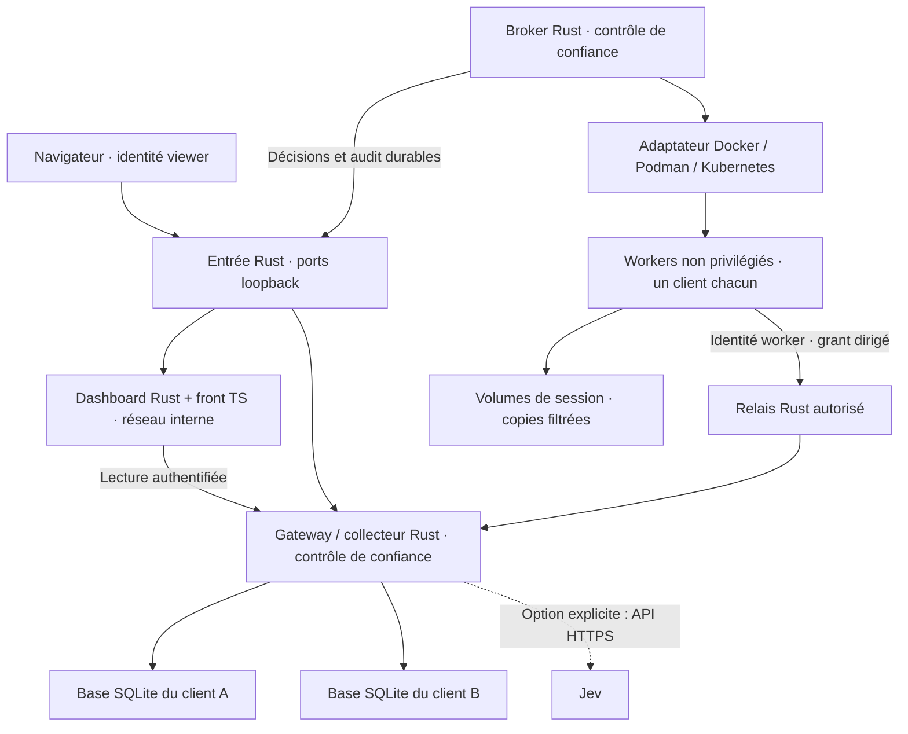

# Architecture, choix techniques et périmètre

Ce document décrit le produit demandé et ses frontières ; il ne qualifie pas son implémentation. Autorités : `AGENTS.md`, `PROMPT_PRODUCTION.md` et `docs/engineering/ARCHITECTURE_CONTRACT.md`. L'état du checkout et les résultats exécutés sont dans `docs/engineering/CURRENT_STATE.md` et `docs/engineering/VALIDATION.md`. Les rapports `docs/validation.md` et `validation.md` sont historiques.

Les chemins cités dans ce document partent de la racine du dépôt, afin de conserver cette copie et `architecture.md` identiques.

## 1. Mandat et décisions validées

Construire un produit open source local-first, avec une déclinaison cloud partageant majoritairement le même code. Il doit être utile, simple à prendre en main, soigné et exploitable. La cible production reste une exigence à démontrer ; un build, des fixtures ou une maquette ne suffisent pas.

Le code applicatif hors frontend est en Rust. Le frontend existant reste en TypeScript et ses fichiers statiques sont servis par un dashboard Rust dans Docker/Podman. Le gateway/collecteur, le dashboard et les workers sont distincts ; le broker Rust appartient au contrôle de confiance. SQLite est conservé avec une base distincte liée durablement à chaque client. Toute modification structurelle exige une décision motivée avant réalisation.

Restent à établir par environnement : moteurs et versions, restrictions effectivement appliquées, ressources, débit, reprise, interfaces fournisseurs, accès et transports cloud. Une configuration `deployment_mode=cloud` et la métadonnée `runtime=kubernetes` ne constituent pas un déploiement cloud ou un adaptateur de lancement de pods.

## 2. Vue d'ensemble cible

Le diagramme représente la cible complète ; registre, relais, usage, Kubernetes et parcours dashboard associés doivent être rapprochés de l'état courant avant toute affirmation de disponibilité. Les Compose historiques ne sont pas une preuve de cette topologie multi-client.

Le navigateur et le dashboard n'obtiennent pas l'autorité runner. Aucun conteneur applicatif ne reçoit le socket moteur, de privilège hôte ni le projet original. Le broker utilise le moteur depuis le poste local ou un service de plateforme appartenant au contrôle de confiance. Déplacer cette autorité ou modifier les frontières impose une décision d'architecture.

Le relais d'entrée local autorisé par le mainteneur transmet vers deux destinations fixes ; seul ce conteneur rejoint aussi le réseau de publication. Il ne monte ni credential, données ni socket et ne journalise pas les secrets qu'il transmet. Gateway/dashboard restent internes. Cette entrée HTTP est distincte du relais métier inter-workers représenté dans la cible.

## 3. Séparation des fichiers et des clients

Chaque session travaille dans un volume alimenté par copie filtrée ; le projet original n'est jamais monté ni réécrit automatiquement. L'export crée une destination neuve, extérieure à l'original. Les liens, traversées, fichiers spéciaux et substitutions concurrentes sont refusés selon les contrats d'import/export. L'existence d'une vérification de chemin ne dispense pas de tests négatifs et d'effets réels.

Le client est choisi par l'identité authentifiée, jamais par un header libre, une querystring, un corps JSON ou un label worker. `runner` appartient au contrôle ; `viewer` consulte son client ; `worker` n'utilise que son relais autorisé, sans accès au registre, aux métriques globales ni aux secrets du contrôle. Chaque worker appartient exclusivement à un client.

G10 vérifie 100 réservations durables pour un client. La recette locale sur moteur utilise trois workers, A1/A2 chez A et B1 chez B, plus les services de contrôle. Les mesures à 100 workers actifs relèvent du dimensionnement. Un même client ne donne pas de droit implicite de communication : le relais exige `source → destination + canal`, avec révocation et durée si configurée ; les échanges entre clients sont refusés.

Sources internes : `docs/engineering/CLOUD_TENANCY.md`, `docs/engineering/LOCAL_CLOUD_TESTS.md` et `docs/engineering/USAGE_METERING.md`.

## 4. Pourquoi Rust et TypeScript

| Option | Décision et conséquence |
|---|---|
| Rust | Langage imposé pour domaine, API, broker, collecteur, runtime, adaptateurs et automatismes applicatifs ; contrats et erreurs restent explicites. |
| Go | Option étudiée historiquement, non retenue ; ne justifie pas un second backend. |
| TypeScript sans framework | Choix conservé pour le frontend existant et ses tests ; le navigateur exécute le bundle statique. |
| React / Vue / Svelte | Pas de migration imposée ; un changement de stack doit répondre à un besoin démontré et respecter les frontières. |
| Python ou JavaScript hors frontend | Pas de nouvelle logique applicative ; les fichiers de configuration et commandes d'utilisation restent déclaratifs. |

Les dépendances résolues et la toolchain sont consignées dans `Cargo.lock`, `front/package-lock.json` et `rust-toolchain.toml`. Node intervient dans le build du frontend ; aucun serveur Node n'est requis en production. Le choix d'une stack légère n'écarte ni accessibilité, ni gestion des erreurs, ni maintenabilité.

## 5. Le sens exact des profils

| Profil | Autorisation au broker | Réseau et limites de preuve |
|---|---|---|
| `strict` | Invocation exacte de l'allowlist ; refus du reste | `none` ; une autorisation de premier niveau ne prouve pas le contrôle individuel de toutes les actions transitives. |
| `review` | Allowlist ou approbation explicite liée au hash de la demande ; refus absolus conservés | `none` ; la confirmation porte sur cette invocation et son contexte. |
| `observe` | Invocation journalisée, refus directs de politique conservés | `none` par défaut ; `bridge` sur choix explicite, sans le présenter comme un filtrage egress applicatif. |

Un agent ne choisit pas son profil depuis le worker. Une commande autorisée peut exécuter du code du projet ; une liste de noms d'exécutables ne suffit pas à maîtriser ses actions internes. Les intégrations natives doivent démontrer leur canal de médiation avant l'action et leurs tests de contournement. Un parseur de logs reste une source de déclarations.

Les secrets injectés dans un worker y sont accessibles. Leur masquage dans les traces ne les protège pas de ce code. Le transport, la gestion des credentials et les restrictions réseau doivent être qualifiés pour le périmètre annoncé, particulièrement en cloud ; un canal non maîtrisé demeure un écart ouvert.

## 6. Cycle d'une action et reprise

1. L'identité authentifiée fixe le client ; les identités de session, agent, sandbox, corrélation et trace sont établies dans ce périmètre.
2. La demande et les traces obligatoires sont durables avant tout effet nécessitant autorisation. Une panne d'audit bloque le parcours, sans repli métier sur l'hôte.
3. La politique déterministe décide ; Jev peut ajouter un refus selon sa configuration sans élargir une permission locale.
4. La décision est enregistrée durablement avant réponse. Refus et attente d'approbation ne créent pas de worker d'exécution.
5. Après autorisation, le broker prépare la copie filtrée et le worker avec réseau, ressources et restrictions fixés, puis soumet le lancement au runtime par programme et arguments séparés.
6. Le démarrage vient d'une observation inspectée du runtime. Le démarrage de son client CLI n'est pas une preuve suffisante.
7. Résultat, erreurs, code de sortie, changements et limites de couverture restent distincts. Une observation terminale manquante laisse un état inconnu à réconcilier.
8. Réservations, transitions de workers, grants, messages, libérations et mesure terminale exigent transactions durables et audit obligatoire. Un replay identique est idempotent ; un contenu divergent pour la même identité est un conflit.

Ces étapes sont des obligations à vérifier dans le code et sur les moteurs ; leur présence dans ce document ne prouve pas leur implémentation. Le redémarrage du dashboard ne doit pas interrompre les contrôles. Les pannes du gateway, du broker et du moteur doivent laisser un état récupérable et une procédure opérateur vérifiée.

## 7. Fournisseurs et Jev

Les contrats et limites d'adaptateurs sont dans `docs/adapters.md`, `docs/compatibility.md` et `docs/sources.md`. Une version fournisseur doit être fixée et testée sur ses interfaces réelles avant de qualifier son intégration. L'arbre générique exige des IDs et parents explicites ; aucun sous-agent ne doit être inventé à partir d'un nom ou d'un texte.

Jev reste optionnel et désactivé par défaut. Son endpoint, modèle et compte sont configurés explicitement ; aucun modèle auto-hébergé n'est supposé. Une erreur, un timeout ou une réponse non concluante ne constitue pas une autorisation. Un serveur HTTP de test prouve un contrat logiciel, pas le comportement d'un modèle distant. Les clés et accès fournisseurs ne sont pas inventés pour fermer une qualification.

## 8. Audit, usage et exploitation

L'audit est conservé hors de l'autorité du worker, dans la base de son client. Les identités, séquences, hashes et contrôles d'intégrité ne doivent pas être confondus avec une signature ou un stockage résistant à une réécriture complète par l'administrateur. Les exigences de rétention, sauvegarde/restauration, migration, saturation et reprise ont leur propre preuve. Les protections supplémentaires telles qu'un ancrage externe sont évaluées selon la menace annoncée ; elles ne sont pas prétendues actives.

Le masquage précède persistance et diffusion. Les corps de messages du relais sont des données métier dans la base client ; l'audit ne les duplique pas. Sans mécanisme de protection explicite, le relais ne doit pas transporter de secrets.

Le modèle distingue `observed`, `declared` et `inferred`, ainsi que couverture native et générique. Une information absente reste inconnue. CPU/RAM alloués × temps ne représentent pas le CPU réellement consommé ; le relevé d'allocation reste `billable=false`, sans prix ni facture avant qualification de l'autorité de mesure, de la réconciliation et des règles commerciales.

## 9. Produit complet, lots et qualification

Les lots du plan `docs/engineering/IMPLEMENTATION_PLAN.md` servent à relire et intégrer progressivement le travail. L'ancien découpage « MVP livré / V2 » est abandonné comme règle de périmètre. Toute exigence obligatoire non satisfaite reste un écart ouvert ; un document de conception ou un mock permanent ne la clôture pas.

L'acceptation porte sur des parcours de bout en bout : installation et diagnostic, authentification, lancement et refus, observation, examen des fichiers, export neuf, arrêt et reprise. L'interface traite chargement, vide, partiel, périmé, déconnexion, interdiction et erreur, avec les données réelles et une action de reprise utile. Elle reste lisible, accessible au clavier, adaptable et légère sous la charge annoncée. La CLI demeure utilisable sans dashboard.

L'exploitation, la compatibilité, les migrations, les sauvegardes/restaurations, la documentation et la contribution font partie du produit. Docker et Podman sont qualifiés séparément sur Linux x86_64 et macOS ARM64. Kubernetes reste un adaptateur obligatoire distinct, avec identité de workload, chiffrement, politiques réseau effectivement appliquées, reprise et autorité de comptage cloud.

Les vues utilisateur et l'administration unifiée selon les permissions Rust sont obligatoires, conformément à `docs/ui.md` et `docs/sso.md` ; elles restent à implémenter et qualifier. MicroVM et intégrations OTLP/Prometheus peuvent être des extensions facultatives lorsque le besoin et les gates le permettent ; elles ne remplacent pas les contrôles et preuves obligatoires. Aucun changement structurel n'est engagé sans décision motivée. La release exige les gates applicables G01–G12, leur preuve acceptable et la fermeture des écarts bloquants, selon `docs/engineering/PRODUCTION_READINESS.md` et `docs/engineering/RELEASE_CHECKLIST.md`.
