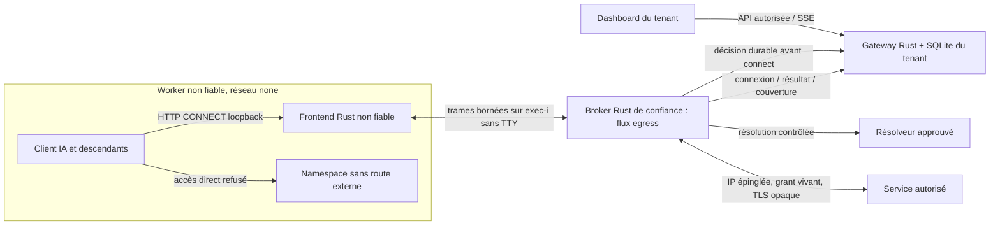

# P1 — contrôle et supervision des sorties réseau

## État de la verticale `broker_proxy_v1` au 24 novembre 2026

Le lot Claude du 22 novembre a introduit le frontal Rust loopback du worker, le protocole de canal et le propriétaire du canal dans le broker. Le contrat de lancement permet de sélectionner ce profil avec un worker en réseau `none`. Le broker inscrit l’ouverture du canal et la décision dans le journal du tenant avant de connecter le flux autorisé. La destination résolue est contrôlée avant la connexion. Le bail et la révocation bornent la durée du flux. [Contrat du canal](../../src/egress/channel_protocol.rs), [propriétaire du canal](../../src/broker/egress_owner/channel.rs).

La suite de la verticale ajoute la lecture des décisions, des observations et de la fermeture du canal dans le Journal, ainsi que des opérations de politique dans le CLI. Les douze sélecteurs du candidat `8b7ff9b5` passent sur un canal de fixture en boucle locale et sur des tests de politique et de CLI. [Validation du 24 novembre](VALIDATION.md#24-novembre-2026--décisions-expiration-et-révocation-du-canal-egress), [gate G05](PRODUCTION_READINESS.md).

Le choix par défaut reste le réseau coupé. Le profil `bridge` est un choix explicite hors médiation. Le raccord E3 au runtime et au superviseur, l’observation indépendante des tentatives directes et les recettes sur workers réels restent ouverts. Les preuves de cette tranche laissent G05, G07 et G11 ouverts. [Proposition E3](G05_E3_BOOTSTRAP_PROPOSAL.md).

## Tranche logicielle du 13 novembre — noyau et protocole vérifiés

Une première tranche Rust est intégrée : politique pure tenant∩session, validation de candidats IP, parseur CONNECT et registre/payloads de flux bornés. [Contrat logiciel FR](EGRESS_SOFTWARE.fr.md), [EN](EGRESS_SOFTWARE.md) et [preuves des 34 parents/toutes cibles](evidence/2026-11-13/egress-core-protocol/README.md) décrivent exactement cette portée. Les valeurs acceptées restent descriptives ; elles ne créent ni autorité, ni socket.

Aucun listener, Store/API/grant, émetteur de permis durable, framing commun, bootstrap ou runtime n’est raccordé par cette tranche. `none|bridge` reste inchangé et bridge non médié. Ni activation Internet, capteur, MITM/PKI, action cluster ou garantie HTTPS n’est livrée. Les obligations et statuts historiques ci-dessous ne sont pas remplacés par les tests logiciels. G05/G07/G11 restent ouverts.

## Décision du 13 novembre 2026 — code et tests logiciels locaux autorisés

Le mainteneur a accepté la direction C présentée dans la [proposition figée au commit `b10c72ff`](https://github.com/Needdoliprane/ai-guard/blob/b10c72ff3b6b0642cf0bdb86af9e98a4ea014cf8/docs/engineering/EGRESS_CONTROL.md) : worker en réseau `none`, frontend Rust loopback non fiable, admission egress distincte et sockets amont possédés par le broker Rust après audit durable. L’accord couvre la conception, le code Rust et les tests logiciels locaux isolés. Les anciens statuts « en attente » ci-dessous décrivent les propositions à leur date.

Cet accord ne couvre aucune activation Internet de worker, nouvelle campagne moteur, installation de capteur, MITM/PKI ni action cloud ou cluster. Il ne modifie pas les admissions du relais existant et ne lève pas l’attente du go pour les travaux Claude en cours. Le frontend ne reçoit aucun credential ai-guard. CONNECT reste un transport TCP opaque ; il ne prouve pas HTTPS effectif ni absence de tunnel. La protection des clés fournisseur reste un chantier distinct.

La première implémentation est répartie entre noyau de politique et protocole/frontend, avec fichiers distincts ; les raccords Store/API/runtime restent sous la responsabilité de l’intégrateur. Aucun filtrage livré, test exécuté ou qualification runtime ne découle de cet accord. L’observation indépendante des tentatives directes, les quatre modes fournisseur et les preuves Docker/Podman/Kubernetes restent exigés ; G05/G07/G11 restent ouverts.

## Réexamen du 12 novembre 2026 — décision EN ATTENTE

Ce réexamen prépare une seule décision motivée sur la direction C ; **aucun nouvel accord, code, filtrage ou résultat de test n'est annoncé**. La lecture actuelle porte sur le public `1e2b5e5a97db0a5df04946f716d11a92421cdc16`. La proposition et les résultats historiques du 6 novembre sont conservés intégralement ci-dessous, avec leurs sources, limites et statuts NOT_RUN.

- Le code expose toujours `None/Bridge` ; la préparation fournisseur exige `observe + bridge` ([runner](../../src/runner.rs#L1357), [contrat de lancement](../../src/control.rs#L440), [construction runtime](../../src/runtime.rs#L217)). Les champs réseau des événements de lancement n'observent pas les destinations. Le [transport stdio du relais](../../src/runtime/managed/relay.rs#L1) reste scellé, sans émetteur production de `RelayExecPermit`, et exige `None`. L'accord du relais antérieur n'est ni un accord Internet ni un émetteur de ce permis ; voir son [périmètre fermé](RELAY_RUNTIME_HANDOFF.md).
- La direction recommandée reste C : worker `none`, frontend Rust loopback non fiable, canal fermé avec admission egress distincte, et sockets amont possédés par le broker Rust après décision durable. Aucun nouveau microservice ni changement implicite des anciens plans, hashes ou modes de réseau.
- **CONNECT opaque n'autorise qu'un transport TCP vers l'autorité/IP/port admis.** Il ne prouve ni HTTPS effectif, ni vérification TLS par un descendant, ni absence de tunnel. Un profil exigeant HTTPS effectif ou absence de tunnel doit être refusé tant que cette propriété n'est pas prouvée ; un nom de destination ou un port 443 ne constitue pas cette preuve.
- Le frontend ne reçoit **aucun credential ai-guard ni secret de contrôle**. Les credentials fournisseur nécessaires au client restent dans la frontière actuelle du worker ; leur protection relève du chantier distinct **RISK-D3**, non fermé par le contrôle egress. Cette direction n'autorise pas implicitement un proxy de credentials.
- DNS/IP/IPv6, redirections et tunnels, refus hôte/contrôle/métadonnées/inter-tenant, audit avant sortie, expiration/révocation, capteur indépendant des tentatives directes, limites Web/MCP distantes et garde Kubernetes effective restent des obligations. `direct_attempts_unobserved`, TLS opaque et `remote_unmediated` ne deviennent pas une couverture complète. Les quatre modes Codex/Claude abonnement/API et les preuves Docker/Podman/Kubernetes restent requis ; la première verticale n'est pas un périmètre suffisant de production. G05/G07/G11 restent ouverts.

**Périmètre de l'accord sollicité : direction C, conception, code Rust et tests logiciels locaux de l'extension egress**, avec contrats/admissions versionnés et contrôles d'isolation habituels. Cet accord n'autoriserait aucune installation de capteur, MITM/PKI implicite, action cluster/cloud, activation d'une sortie Internet de worker ou nouvelle campagne moteur avant ses propres prérequis et admission. Toutes ces activations et qualifications gardent leurs conditions distinctes. **La décision demeure EN ATTENTE.**

## Proposition historique du 6 novembre — texte conservé

Statut au 6 novembre 2026 : **proposition d'architecture à soumettre au mainteneur**. Produit en développement ; aucune implémentation, aucun filtrage nouveau et aucune qualification moteur ne sont livrés par ce document. G05/G07/G11 restent ouverts. La décision recommandée ci-dessous appartient à l'auteur de la proposition, pas au mainteneur tant qu'elle n'est pas acceptée.

Base de la lecture de code : `e9415acf57cc815b0ff4ce3bd1f487e8a5b250a6`, checkout secondaire `codex/egress-control-design-20261106`. Les consignes communes d'`AGENTS.md` et les contrats canoniques `docs/sso.md` / `docs/ui.md` ont été lus dans le checkout principal, en préservant ses modifications ; le bloc historique Memory Context n'est pas une preuve. Les références de lignes ci-dessous portent sur cette base, pas sur un binaire déployé. Travail de conception et lecture de sources uniquement : aucun test, moteur, cluster, modèle, service d'infrastructure/fournisseur ou credential n'a été utilisé. Les consultations de documentation publique officielle sont indiquées séparément.

Empreintes Git des fichiers principaux effectivement lus : `AGENTS.md` = `220d85a2cedb1fac351df2aab8d4c8dedfa30f46`, `docs/sso.md` = `344daf7825f12a331075191880468b48f53ac619`, `docs/ui.md` = `4825ea037bcb581c13dfdc417b6df4566e395640`. Ces empreintes identifient les contenus, sans publier de configuration privée.

Complément de conception après challenge du coordinateur : lecture du checkout `human-brokers-validation-20261104` au SHA `0b09d96c0dbf977ccb4f95fafe9ba650d5d730f7`, uniquement pour la [proposition de sessions Kubernetes V2](https://github.com/Needdoliprane/ai-guard/blob/0b09d96c0dbf977ccb4f95fafe9ba650d5d730f7/docs/engineering/KUBERNETES_ADMISSION.md#proposition-du-6-novembre--sessions-exécutables-et-canal-worker) et la [coordination du canal commun](https://github.com/Needdoliprane/ai-guard/blob/0b09d96c0dbf977ccb4f95fafe9ba650d5d730f7/docs/engineering/DECISIONS.md#coordination-proposée-le-6-novembre-avec-les-sessions-kubernetes-v2). Ces deux extensions attendent encore une décision du mainteneur ; leur lecture ne transfère ni accord ni preuve de runtime. L'option C ci-dessous est la proposition du coordinateur retenue pour recommandation après analyse, pas une approbation du mainteneur.

## 1. Besoin et critère de résultat

Un utilisateur doit voir quelles destinations une session essaie de joindre, pourquoi une sortie est refusée, comment demander une permission, quand elle expire et si sa révocation est effectivement appliquée. Tous les processus du worker, dont le client IA et ses descendants, sont soumis à la même frontière réseau. Une variable d'environnement, une décision Jev ou un événement fourni par le client ne constituent pas cette frontière.

Le résultat attendu combine :

- refus réseau par défaut, y compris hôte, contrôle, autres tenants, métadonnées et destinations inconnues ;
- politique effective du tenant restreinte par celle de la session, avec autorisations temporaires, expiration et révocation ;
- décision durable dans la base du tenant **avant toute connexion amont autorisée** ;
- observation indépendante de la tentative de connexion et de son résultat, sans transformer une permission en effet constaté ;
- attribution au tenant/session/worker/tentative authentifiés, avec agent et sous-agent seulement lorsqu'une preuve le permet ;
- dashboard unique du tenant, provenance et fraîcheur visibles, erreurs et couverture partielle explicites ;
- preuves distinctes Docker, Podman et Kubernetes réels, revues indépendantes et guides EN/FR synchronisés.

Les événements réseau n'enregistrent par défaut ni corps, ni URL complète, ni paramètres, ni `Authorization`, cookies ou headers applicatifs bruts. Le filtrage ne rend pas sûr le contenu d'une destination autorisée. La réputation et Jev restent des avis bornés qui ne peuvent lever un refus impératif.

Un nom d'hôte inconnu et un message d'erreur de parsing sont aussi des données non fiables : appliquer le masquage avant persistance, outbox et diffusion. Si un littéral sensible reconnu apparaît dans l'autorité, ne conserver que le motif et une référence opaque/digest utile à la corrélation ; ne pas l'envoyer à un résolveur pour produire une preuve. Les noms internes et adresses restent soumis aux permissions de métadonnées et à la rétention du tenant ; aucune promesse de reconnaissance universelle des secrets.

## 2. Cartographie du code réellement lu

| Couture existante | Source sur la base examinée | Ce qu'elle apporte / ce qu'elle ne prouve pas |
|---|---|---|
| Modes de réseau | [runtime.rs:103](../../src/runtime.rs#L103), [control.rs:30](../../src/control.rs#L30) | `None` et `Bridge` seulement. Aucun mode de sortie médiée ni contrat de destination. |
| Construction du worker | [runtime.rs:292](../../src/runtime.rs#L292) | Produit `--network none` ou `bridge`, UID1000, capabilities supprimées, racine readonly, limites et absence de logs moteur. `bridge` ne porte aucune règle de sites/services. |
| Relecture du conteneur | [managed.rs:1785](../../src/runtime/managed.rs#L1785), [managed.rs:1819](../../src/runtime/managed.rs#L1819) | Vérifie mode et réseaux attachés contre la spécification. Ne vérifie pas une garde réseau, DNS, proxy ou politique de destination. |
| Identité runtime disponible | [managed.rs:872](../../src/runtime/managed.rs#L872), [managed.rs:984](../../src/runtime/managed.rs#L984), [runtime.rs:1555](../../src/runtime.rs#L1555) | Handle d'autorité/CID exact, observations sélectionnées et RestartCount existent. Le binding durable StartedAt/exec/époque et son contrôle continu restent à développer ; ne pas les attribuer au simple `validate_identity_allocation` actuel. |
| Admission fournisseur | [runner.rs:1175](../../src/runner.rs#L1175), [runner.rs:1217](../../src/runner.rs#L1217), [control.rs:440](../../src/control.rs#L440), [runtime.rs:221](../../src/runtime.rs#L221) | Le réseau doit être demandé explicitement en `observe` + `bridge` pour les credentials fournisseurs. Ce n'est ni un filtrage Internet ni une autorisation de relais entre workers. |
| Routes Codex préparées | [bootstrap.rs:254](../../src/provider/bootstrap.rs#L254) | Épingle les routes fournisseur dans les arguments de configuration du client. Un autre processus peut tenter une autre destination ; ce choix ne confine pas le réseau. |
| Couverture observateur | [managed.rs:1820](../../src/runner/managed.rs#L1820), [managed.rs:2336](../../src/runner/managed.rs#L2336) | Déclare les limites du cycle runtime et l'absence de médiation des appels imbriqués. Des logs client après exécution ne prouvent pas une décision réseau avant connexion. |
| Pile de contrôle | [Compose Docker](../../deploy/docker/compose.yaml), [Compose Podman](../../deploy/podman/compose.yaml), [contrat d'architecture](ARCHITECTURE_CONTRACT.md) | Gateway/dashboard sur `control` interne ; ingress Rust à destinations fixes sur `control` et `publication`, ports hôte loopback. Les workers lancés par le broker ne rejoignent pas ces réseaux. Ce relais d'entrée ne doit pas devenir un proxy de sortie libre. |
| Relais métier dirigé | [relay.rs:96](../../src/relay.rs#L96), [api/relay.rs:1](../../src/api/relay.rs#L1), [audit/relay.rs:1](../../src/audit/relay.rs#L1) | Grants de messages source → destination + canal, identité worker vérifiée, expiration/révocation et audit SQLite. Ni tunnel TCP, ni moteur de politique Internet. Réutiliser les invariants, pas le sens de ces grants. |
| Transactions durables | [audit.rs:867](../../src/audit.rs#L867), [audit.rs:963](../../src/audit.rs#L963) | Store vérifié et commit avant publication. Couture à étendre, sans base commune multi-tenant ni accès SQLite depuis le worker. |
| Préparation Kubernetes | [kubernetes.rs:249](../../src/runtime/kubernetes.rs#L249), [admission_profile.rs:66](../../src/runtime/kubernetes/admission_profile.rs#L66) | Types/préflight/admission held existent ; le profil désactive host namespaces/token et configure DNS isolé. Le code nomme `NetworkEnforcementNotProven`. Il ne livre pas une exécution d'agent ni une sortie contrôlée qualifiées. |
| Consultation actuelle | [types.ts:78](../../front/src/types.ts#L78), [main.ts:1707](../../front/src/main.ts#L1707), [ui.md](../ui.md) | Affiche le mode de réseau reçu et les événements. Aucun registre de tentatives/grants réseau ni mutation de permission réseau identifiés. La consultation viewer ne confère pas un droit d'approbation. |
| Régressions actuelles | [runtime_security.rs](../../tests/runtime_security.rs), [runtime_confinement.rs:57](../../tests/runtime_confinement.rs#L57), [TEST_STRATEGY.md](TEST_STRATEGY.md#qualification-par-runtime) | Arguments de confinement et tests moteur opt-in du mode sans réseau. Leur existence ne constitue pas un résultat sur ce checkout ; ils ne qualifient pas le nouveau chemin P1. |

La recherche ciblée dans `src/`, `front/src/`, `tests/` et `deploy/` n'a pas identifié de proxy egress produit ni de politique Internet par destination. `jev_egress` dans l'override Compose ouvre une sortie au contrôle pour Jev ; ce nom de réseau ne constitue pas un filtre. Le [guide PKI](../../INFRASTRUCTURE_PKI.md#flux-sortants) décrit déjà cette limite du mode bridge. Le [contrat multi-client](CLOUD_TENANCY.md), la [recette A1/A2/B1](LOCAL_CLOUD_TESTS.md) et le [relevé d'allocation](USAGE_METERING.md) restent applicables.

## 3. Trois approches dans la frontière Rust

| Approche | Mécanisme et avantages | Coût, risque et limites |
|---|---|---|
| **A — proxy explicite obligatoire + garde réseau indépendante** | Un point de sortie Rust de confiance reçoit HTTP/CONNECT sur un segment réseau dédié. Le réseau du worker permet uniquement ce point, sur le port et l'interface de sa tentative ; les autres voies sont refusées hors du worker. Le proxy décide/audite puis résout et connecte l'amont. | Exige de nouvelles gardes VM/hôte/CNI et leurs droits. Le mécanisme concret Desktop/rootless n'est pas établi : cette dépendance retarde inutilement le premier profil local alors que le mode `none` existe. Les variables proxy ne sont jamais une garde. |
| **B — passerelle transparente L3/L4 + résolution contrôlée** | Le réseau force chaque paquet vers une passerelle pilotée en Rust, avec traitement des flux et DNS. Des processus ignorant les variables proxy peuvent fonctionner pour les protocoles réellement pris en charge. Politique et audit restent dans le contrôle, avec garde hors worker. | Interception/routage, suivi des flux, réassemblage, IPv6 et corrélation DNS/IP augmentent fortement la surface. Une association DNS→IP ne prouve pas le nom utilisé sur TLS ; CDN partagés, IP directe, DoH, ECH et tunnels restent à traiter. Les mécanismes VM/rootless/CNI diffèrent ; une redirection iptables isolée ou SNI seul ne suffit pas. |
| **C — worker `none`, frontend proxy loopback non fiable, flux sur le canal moteur retenu** — recommandée | Garder Docker/Podman en `--network none`. Un petit frontend Rust dans le worker accepte HTTP/CONNECT sur loopback et traduit les requêtes en trames non fiables sur le canal `exec -i` sans TTY. Le broker de confiance possède seul résolution, sockets amont, audit, grants et révocation. Réutiliser le canal fermé proposé pour relais/session, avec extension de flux explicitement négociée. Aucun listener TCP de contrôle ou route Internet n'est remis au worker. | Nouveau preset/bootstrap, duplex/EOF/exclusivité à qualifier et support proxy des clients à vérifier. Le frontend peut mentir ou être tué ; sa sortie ne prouve rien au-delà du worker lié. Les sockets directs sont bloqués mais leur tentative n'est pas observée par le frontend. Portée TLS/tunnels opaques identique aux autres options. Kubernetes demande encore une garde CNI effective. |

**Choix proposé : C pour Docker/Podman et comme extension logique du canal commun Kubernetes V2.** Il donne une voie locale concrète sans nouvel administrateur de firewall VM, réseau bridge, daemon TCP ou montage hôte : le broker emploie son invocation moteur déjà approuvée, le worker conserve `none`, et seul un flux de demandes bornées traverse des pipes possédés. La sortie réelle est un effet Rust du broker autorisé avant `connect`. A et B restent des alternatives à soumettre si les preuves du canal ou la compatibilité client échouent ; aucune activation réseau automatique ne sert de repli. Un appel de client qui ignore le proxy échoue fermé.

Un proxy environnemental seul, un réseau partagé entre workers, une liste d'IP déduite des réponses DNS et une ouverture permanente vers le fournisseur sont écartés : ils laissent un chemin sans décision par connexion ou mélangent les autorités. Une interception TLS générale n'est pas proposée. Elle impliquerait une autre décision de confiance/PKI et de traitement des contenus, ainsi qu'une qualification client dédiée ; elle ne peut être ajoutée implicitement pour améliorer un libellé de couverture.

## 4. Changements structurels à soumettre avant code

L'approbation générale du besoin P1 et la proposition du coordinateur ne valent pas décision du mainteneur. Soumettre concrètement, en une direction cohérente avec les propositions relais/session :

1. **L'extension de flux egress du même canal fermé broker↔worker**, partagé avec send/inbox/ACK et session V2. Le format exact commun et ses limites ne sont pas encore figés ; ne pas créer un deuxième framing, un proxy d'administration générique ou une URL amont fournie librement dans une trame. Les opérations réseau sont négociées/autorisées séparément de Ready, handoff, release et relais.
2. **Un frontend Rust non fiable dans l'image et un nouveau preset/bootstrap retenu**, avec listener limité au loopback du worker, `none` inchangé sur Docker/Podman, aucun privilège ou montage ajouté. Sa mise en route via `exec -i` et sa conservation par le broker demandent les preuves duplex, exclusivité d'époque et quiescence de la proposition de canal existante. Aucun mot de passe de proxy, credential runner/SSO ou socket moteur n'est remis au frontend.
3. **Le moteur de sortie dans le broker Rust existant**, avec limites et acteur de connexion/grant, sans nouveau daemon de confiance ni nouvelle base. Le broker conserve l'autorité de contrôle et reconstruit seulement les opérations egress autorisées. Tenant et binding viennent de sa capacité de transport, jamais des champs du frontend. Le transport distant broker↔gateway relève de [G11 et PKI](INFRASTRUCTURE_PKI.md).
4. **De nouveaux contrats versionnés d'admission et d'egress**, avec migrations et conservation des plans fournisseurs1/2/3, fingerprints et claims historiques. C conserve le réseau physique `None` et ajoute un axe egress/binding de canal dans un nouveau profil de lancement ; ne pas donner un nouveau sens à `None`, `Bridge` ou aux hashes historiques. Les anciennes contraintes credentials+bridge ne sont pas contournées : un dispatch de version/preset explicite prépare le nouveau handoff privé et conserve le refus des combinaisons anciennes.
5. **La garde CNI effective pour Kubernetes**, avant attach/release, sans prétendre que le profil tenu ou une NetworkPolicy seule suffisent. Docker/Podman C n'exige pas une nouvelle garde de routage VM ; son invariant `none`, ses capacités supprimées et l'absence de voies hôte doivent néanmoins être inspectés et qualifiés par effets sur chaque moteur.
6. **La portée publique HTTPS et de supervision** : destination de transport autorisée, contenu chiffré opaque, exécution distante hors garde locale et tentatives directes bloquées mais non observées par le frontend. Un profil exigeant une observation exhaustive ou une garantie TLS non fournie reste refusé ou non qualifié ; ces limites ne ferment aucun gate par rédaction.
7. **Le capteur indépendant des tentatives directes**, dans le contrôle/noyau runtime : mécanisme, lieu réel d'observation, droits minimaux et disponibilité par plateforme à concevoir et qualifier avant d'annoncer un profil P1 complet. Son absence reste un écart obligatoire ; une instrumentation dans le worker ou un log fournisseur ne peut recevoir la provenance `observed` indépendante. Aucune installation de capteur VM/nœud ou permission supplémentaire n'est autorisée par cette proposition.

L'accord demanderait conception détaillée, code Rust et tests locaux de cette extension commune. Il n'autoriserait ni installation OS, action cluster/cloud/PKI ni qualification d'un runtime manquant. Les prérequis d'activation et la supervision indépendante du CLI restent obligatoires.

## 5. Topologie et propriété des identités

Les flèches décrivent des protocoles à développer. Le saut loopback reste dans le worker ; aucun socket hôte ou moteur n'y est monté. Le broker lance un programme Rust absolu approuvé avec arguments séparés, `exec -i` sans TTY, dans le CID exact. Il possède stdin/stdout et le child moteur avec son cycle de vie ; stderr est drainé séparément et borné, sans journaliser les octets bruts distants. Le canal est distinct du `start --attach` métier et du PTY interactif fournisseur. Aucun octet métier affiché n'est interprété comme une trame egress, aucun octet egress n'est injecté comme commande TTY.

Le frontend sert uniquement d'adaptateur de bytes dans la frontière non fiable. Il n'évalue pas une règle, n'approuve pas un grant, ne signe pas un résultat et ne donne aucune identité au broker. Il peut être remplacé, tué, forger une autorité ou émettre des trames adverses : le broker continue de traiter chaque entrée comme une demande non fiable du worker lié. Une compromission peut bloquer le service ou détourner les requêtes **dans les permissions de ce worker** ; elle ne crée ni accès inter-tenant, ni décision allow, ni nouveau socket externe dans le worker.

| Transport | Autorité et séparation requises |
|---|---|
| Client→frontend | HTTP/CONNECT sur `127.0.0.1`, port du profil figé avant release, sans authentifiant de contrôle. Le frontend n'écoute ni `0.0.0.0` ni une interface du runtime. Chaque processus du même worker peut le joindre ; cela ne prouve pas lequel. |
| Frontend→broker | Pipes de l'exec retenu, version/capacités négociées une fois, binding possédé hors payload. Les champs de corrélation reçus sont comparés au contexte déjà établi, sans pouvoir choisir un tenant/worker ou une autre époque. Aucun endpoint HTTP de contrôle n'est relayé librement. |
| Broker→gateway | Contrats typés de permis/observation, autorité broker authentifiée et contexte tenant vérifié. Le frontend ne reçoit jamais les preuves ou tokens de contrôle ; seuls codes de résultat publics et données du flux autorisé lui reviennent. |
| Broker→résolveur/amont | Sockets créés côté confiance après autorisation durable et validation d'adresse ; aucune résolution externe dans le frontend et aucun transfert L3. Les accès locaux possibles depuis le broker sont refusés par validation de destination, indépendamment du refus réseau du worker. |

Le contrôle crée un binding immuable `(tenant authentifié, broker/autorité, session, worker, attempt, génération, CID complet, StartedAt, RestartCount, empreinte de confinement, époque de transport)`. Le handle d'exec appartient au runtime approuvé et au CID inspecté ; jamais à un nom réutilisable ou un `--latest`. L'inspection avant ouverture puis après création du canal doit confirmer le même processus vivant et la même configuration ; une donnée manquante ou divergente bloque. L'exclusivité centrale est celle du canal commun proposé : acquisition/CAS/révocation auditée par sujet `worker+attempt+generation`, sans deuxième propriétaire egress ni ancien binding encore actif. Le handshake frontend ne crée pas cette capacité.

Une inspection avant/après n'est pas une précondition atomique du moteur. Le broker sérialise ses propres starts/stops/epochs, suit la vie du handle et réinspecte le processus ; un redémarrage concurrent externe ou un canal ambigu invalide l'époque et ferme tous les flux. Aucun réattachement n'est permis tant que la quiescence de l'ancien exec est inconnue, même si son client local est mort. Le même principe s'applique à l'attach Kubernetes, avec autorité/NamespaceUID/PodUID et protocole remotecommand retenus ; attach par nom ne fournit pas une précondition PodUID atomique.

Les réponses et sockets amont restent liés à `(binding, époque, flow_id)` créé/validé par le broker. Une trame A1 ne choisit ni le contexte de A2 ni celui de B1. Sans preuve plus fine, l'acteur est **le worker observé** ; noms d'agent/sous-agent/PID fournis par le frontend restent déclarés. Le frontend peut ignorer une réponse de fermeture, mais le broker ferme son socket amont et arrête de transmettre : le frontend ne possède aucune route pour le recréer.

### Extension de flux et bornes à figer avec le canal commun

La négociation commune annonce explicitement une capacité egress, sa version et ses plafonds effectifs, approuvés dans l'admission. Son absence conserve relais/session sans permettre de socket amont. Aucune tentative de repli sur TCP, réseau bridge ou second bootstrap. Les noms d'opérations ci-dessous décrivent une **proposition de sémantique**, pas des opcodes ou un format wire déjà figés :

- `Open` contient seulement un identifiant local de corrélation et une autorité structurée `(nom, port, protocole)` ; le broker attribue l'identité globale et n'accepte aucune URL libre, requête gateway ou credential de contrôle. `Accepted/Rejected` vient uniquement du broker après le reçu approprié ; un worker ne peut pas s'envoyer un allow.
- `Data` appartient à un flux accepté et ne dépasse jamais la fenêtre de crédit de son sens. Le broker ne connecte ni ne transmet de payload reçu avant allow ; ces octets prématurés sont refusés, sans tampon d'attente illimité. Les contenus restent opaques, hors audit/outbox/captures.
- `Credit`, `HalfClose`, `Reset/Closed` sont liés au flux/époque et à un sens. Débordement, doublon illégal, ordre invalide, flux inconnu, type inconnu ou version inattendue ferment le flux ou le canal selon la gravité, sans sortie réseau supplémentaire. `Closed` distant ne vaut ni terminal worker ni fin d'allocation.
- Le multiplexage conserve des classes et quotas séparés pour lifecycle/STOP, relais métier et egress ; une rafale `Data/Open` ne retarde pas indéfiniment stop, invalidation ou révocation. Arbitrage équitable par flux et tenant, limites avant allocation, une seule queue bornée par sens ; aucun spawn non borné par trame. Les trames métier/release ne sont jamais interprétées dans la classe egress.

Bornes de départ **proposées**, à harmoniser avec les plafonds communs avant code : autorité ≤ 512 octets et en-têtes locaux ≤ 16 Kio ; trame de données ≤ 16 Kio ; 16 flux vivants et 4 Open en attente par worker ; au plus 256 Kio de crédit non acquitté par sens/worker ; mémoire totale de buffers du canal ≤ 1 Mio/worker ; débit d'ouverture ≤ 4/s avec rafale 8. Le tenant et le broker ont aussi des plafonds globaux, dimensionnés pour préserver l'audit et STOP ; le budget des autres classes est réservé séparément. Lire la taille, vérifier arithmétique/quotas et réserver avant tout `Vec` ou tâche. Fenêtres et IDs ne se réinitialisent pas en rejouant un handshake ; les flux ne sont jamais rejoués à une nouvelle époque. Les délais d'entête/handshake/Open/idle et le traitement des demi-fermetures doivent être figés dans le même contrat et testés par vrai duplex.

Une demi-fermeture est **logique par flux** : après drainage autorisé de son sens, le broker applique `shutdown(write)` au seul socket concerné et peut encore recevoir sa réponse. Il ne ferme pas stdin de l'exec pour terminer un flux multiplexé ; EOF du transport ferme tous les flux et invalide l'époque. Un `Reset` de révocation abandonne les buffers non envoyés et ferme immédiatement le socket ; aucune queue d'un autre flux ne peut ressusciter sa destination.

Frontend HTTP local : un parseur standard Rust unique, grammaire et limites fermées, aucune confusion CL/TE ni autorité `Host` divergente. Pour CONNECT, répondre succès seulement après confirmation broker ; le contenu ultérieur est un flux opaque. Le broker revalide lui-même le DTO Open et tous les états, même si le frontend prétend avoir déjà parsé ou autorisé. Un frontend compromis ne peut contourner ces vérifications en injectant du HTTP dans les bytes d'un flux : ceux-ci n'ouvrent pas de nouveau flux.

### Bootstrap, loopback, clients et credentials

Le preset commence par un bootstrap Rust vérifié et retenu, image/ENTRYPOINT/permissions/commande fixés, avant toute exécution du workspace ou du fournisseur. Ordre proposé : confinement `none` inspecté → canal exclusif acquis et exec observé → frontend loopback prêt déclaré **et prérequis indépendants vérifiés** → état Running central acquitté → marqueur durable irréversible de release → libération métier unique. `Ready` du frontend n'est ni une preuve de sûreté ni une autorisation de release ; perte/ambiguïté de réponse ⇒ arrêt/réconciliation du même CID, sans nouveau start/release. L'échéance originale armée reste prioritaire et n'est pas prolongée par une tentative de connexion ou de reprise.

Choix local initial : proxy `http://127.0.0.1:<port_du_profil>`, pas le nom `localhost` supposé résoudre en `::1`. Docker documente l'absence d'adresse loopback IPv6 dans son driver none. Si le profil Podman configure `::1`, une écoute IPv6 doit être explicitement loopback-only avec `IPV6_V6ONLY`, sans wildcard ni route ; elle reste à qualifier. Aucune création d'interface/capacité n'est ajoutée pour corriger un client imposant IPv6 : diagnostiquer le refus de profil. Les tentatives IPv6 directes restent des essais de confinement distincts.

Le contrôle prépare explicitement les variables proxy reconnues par le client, variantes de casse cohérentes, `NO_PROXY` contrôlé sans joker et aucune découverte de proxy hôte. Ces variables servent à trouver le frontend ; les supprimer ne donne pas de réseau. Le frontend n'est pas un navigateur de login, un proxy SOCKS ou une API générique. Claude documente le support HTTP/HTTPS proxy et l'absence de SOCKS ; cela ne prouve ni les versions d'ai-guard ni Codex, streaming, abonnement, refresh, MCP ou sous-processus. Chaque combinaison client/mode/version garde ses essais réels ; une dépendance hors contrat échoue avec destination manquante, sans ouverture large ou basculement API.

API/subscription : conserver le handoff privé minimal du broker au seul client/mode retenu, par le bootstrap/canal autorisé ; aucun montage de keychain/cache OAuth/répertoire de clés hôte, aucun `.env` complet, aucune clé en argv ou trame d'audit. L'exec frontend reçoit un environnement explicite sans credential ; ne pas copier par commodité l'environnement du fournisseur ou celui du shell hôte. L'authentification d'abonnement suit le mécanisme officiel préparé, sans extraire implicitement un cache. Le frontend partage cependant la frontière non fiable du worker : même UID, `/proc` ou processus compromis peuvent exposer des credentials nécessaires au client ; ce design ne promet aucune protection de clé **contre les autres processus de ce même worker**. TLS et le contrôle des destinations réduisent certains chemins sans supprimer ce risque ni l'exfiltration vers une destination autorisée.

## 6. Contrats et ordre des effets proposés

Ces noms et routes sont des propositions, pas une API actuelle. Tous les objets sont fermés, bornés, typés et versionnés ; une version inconnue est refusée.

| Contrat | Champs et règle d'autorité |
|---|---|
| `EgressPolicyV1` | Révision/digest, destinations exactes normalisées, ports/protocoles, résolveur approuvé, profils internes explicitement permis, limites/TTL, permissions de demande/approbation. La politique session restreint celle du tenant ; aucun choix utilisateur ne l'élargit seul. |
| `EgressBindingV1` | Références de session/worker/tentative, identité broker/autorité, propriétaire/époque exclusifs du canal, CID/StartedAt/RestartCount ou identité Pod retenus, preuve d'inspection et digest du profil réseau/egress. Tenant issu du contrôle authentifié, jamais désérialisé d'une demande frontend. |
| `EgressAttemptV1` | ID créé par le broker, séquence locale, binding/flow_id, autorité demandée `(nom ASCII canonique, port, protocole)`, type et source/provenance. Pas d'URL ni de headers bruts. C produit les demandes du proxy ; une tentative directe exige le futur capteur indépendant et peut avoir seulement IP/port, nom et acteur fin inconnus. |
| `EgressDecisionV1` | `allow`, `deny` ou `review`, motif fermé, révision politique, grant éventuel, bornes de validité, digest de résolution/ensemble d'IP validé, identité du décideur et reçu `audit_seq`/hash. `review` bloque le flux ; il ne le maintient pas ouvert indéfiniment. |
| `EgressGrantV1` | ID/opération/hash idempotents, sujet lié à la tentative ou session, destination exacte, port/protocole, borne `not_before/expires_at`, approbateur autorisé, révision, état révocable. TTL plafonné par le contrôle ; aucun wildcard ou sous-domaine implicite. |
| `EgressConnectionV1` | ID de connexion distinct, décision liée, IP/port réellement tentés et pair observé, `connect_started`, `connected`, `failed`, `closed` ou `unknown`, motif et source. Volumes/durée n'existent que si le producteur les a mesurés. |
| `EgressCoverageV1` | Profil/versions de garde et proxy, période, interfaces/sources attendues et observées, fraîcheur, pertes/agrégations, HTTPS opaque, outils distants, résultat de réconciliation. Pas de booléen global « sécurisé ». |

Ordre d'une connexion :

1. Valider binding vivant, bornes de parsing et autorité ; refuser userinfo, caractères de contrôle, autorité ambiguë, IP littérale non autorisée et protocole/port hors contrat. Canonicaliser IDNA, casse et point final avec une règle unique ; les formes non prises en charge sont refusées, pas rapprochées par heuristique.
2. Vérifier la politique avant toute résolution externe. Une destination inconnue produit `deny/review` sans requête DNS externe portant ce nom. Les recherches DNS font elles-mêmes partie des sorties contrôlées ; leur résolveur/fonction doivent être admis durablement. Ne pas offrir un résolveur récursif général au worker.
3. Résoudre depuis le contrôle, avec délais, tailles et chaîne CNAME bornés ; valider **toutes** les adresses candidates IPv4/IPv6 contre les plages interdites et les services internes exacts. Refuser une réponse mixte douteuse plutôt que sélectionner discrètement son adresse publique. Le nom CNAME n'est pas une permission de service supplémentaire ; conserver sa provenance sans le transformer en autorité demandée.
4. Dans une transaction de la base du tenant, revalider binding/politique/grant/horloge, réserver les budgets et persister tentative, décision et permis de connexion à usage unique. Un échec du commit ou du reçu bloque toute connexion amont. La résolution est un fait distinct de la décision finale.
5. Sous l'acteur sérialisé du grant/binding, vérifier encore époque, révocation et échéance ; consommer le permis une seule fois et seulement alors appeler `connect` vers l'adresse numérique retenue. Aucun second DNS implicite par un client HTTP. Chaque repli d'adresse a son identité/autorisation ; une reprise ambiguë ne reconnecte pas silencieusement.
6. Persister séparément le résultat réellement observé. Le crash après permis mais avant résultat laisse `unknown`, jamais `connected` inféré. Aucun octet du worker n'est transmis à l'amont avant la décision durable. Une perte d'audit pendant un flux ferme le passage des données et déclenche sa réconciliation ; un retour au mode bridge est interdit.

Le permis ne peut être échangé contre une connexion à une autre destination. HTTP non chiffré éventuel exige une politique distincte ; par défaut le profil Internet autorise seulement CONNECT sur les ports TLS explicitement admis. Le proxy ne propose pas de SOCKS général, `CONNECT-UDP`, port SSH ou API explicite de tunnel/upgrade. L'éventuel support d'un de ces protocoles exige son contrat et ses preuves. Cette restriction ne prétend pas identifier un WebSocket ou autre tunnel caché dans une session TLS pass-through, dont la limite reste décrite en section 8.

Les lectures proposées `GET /api/v1/egress/{attempts,grants,coverage}` suivent le contexte authentifié, pagination et permissions de métadonnées. Les mutations de demande, approbation et révocation utilisent les permissions humaines/broker vérifiées côté Rust, une opération idempotente et un reçu durable. Un viewer historique garde seulement ses lectures. Le chemin de données du proxy ne peut appeler aucune route administrative. Les routes définitives et leur projection dashboard devront être décrites ensemble dans les guides API et EN/FR.

## 7. Concurrence, expiration, révocation et reprise

La transaction SQLite et une connexion TCP ne sont pas atomiques. La proposition publie donc leurs deux points de linéarisation : le commit du permis autorise un effet borné ; l'acteur de données sérialise l'émission de `connect`, l'expiration et les invalidations. Une révocation concurrente peut laisser une connexion déjà émise ; elle doit être fermée, pas niée dans l'historique.

- Révocation : commit `revoke_requested` bloque tout nouveau permis côté contrôle, notification à chaque point de sortie lié, incrément d'époque, fermeture des flux couverts, puis accusé observé `revoke_applied`. L'API et le dashboard affichent **en application** tant que tous les points attendus n'ont pas confirmé. Aucun ACK final de révocation n'est rendu avant cette barrière ; le délai et les octets en vol sont mesurés, pas annoncés nuls.
- Nouvelle connexion et révocation du même grant sont sérialisées au point de sortie. Un permis de l'ancienne époque est inutilisable après la barrière. Un commit contrôle intervenu après le dernier test local peut précéder un `connect` déjà en cours : conserver l'ordre constaté et fermer ce flux à réception de l'invalidation. Ne pas promettre un arrêt mondial instantané au commit.
- Expiration : conserver l'identité de boot/horloge et l'origine monotone locale **avant l'envoi de la demande centrale** de permis ou de renouvellement. Le reçu borne une échéance calculée depuis cette origine, jamais depuis sa réception. Un ACK tardif, un rejeu, une reconnexion ou un redémarrage ne donne aucune durée neuve. Le contrôle revalide son plancher UTC durable à chaque mutation ; un permis reçu après son échéance est refusé. Pour un flux actif, l'ancien bail reste la borne pendant le renouvellement : s'il expire, fermer le flux, sans réouverture sur ACK tardif. Tester le patron d'horloge retenue avant le lot E1. Horloge incohérente, reboot ou binding sans preuve ⇒ pas de nouvelle sortie, état à réconcilier.
- Partition contrôle/proxy : aucune nouvelle connexion sans commit en ligne. Les flux actifs possèdent un bail court renouvelable par audit durable ; perte de renouvellement, époque incertaine ou garde non fraîche ⇒ coupure au plus tard au terme du bail. Le plafond de ce bail, du délai de coupure et des buffers doit être choisi, publié puis mesuré avant qualification, sans transformer un timeout coopératif en garantie dure.
- Perte/kill du frontend, EOF, erreur de parsing ou sortie du client moteur : fermer immédiatement tous les sockets amont liés et invalider l'époque de données ; aucune nouvelle ouverture/credit. La fin du pipe local ne prouve ni fin de l'exec distant, ni terminal worker ou libération de quota. Aucun réattachement/nouvel exec/adoption tant que l'ancien canal n'est pas prouvé quiescent selon le contrat commun. Une réponse ou un Open perdu ne sera pas rejoué vers le service.
- Crash/restart du broker : `none` continue de refuser toute sortie directe ; le frontend n'a plus de serveur capable de connecter. La supervision propriétaire du canal et des sockets doit survivre au client CLI et être rattachée au service/gardien existant. La perte de ce propriétaire doit entraîner fermeture effective des FD, pas seulement suppression d'un objet en mémoire. Après reprise, aucun flux, permis ou buffer n'est restauré comme vivant : réconcilier identité/runtime/époque, prouver quiescence, acquérir une époque neuve sous autorité fraîche et rétablir seulement de nouvelles connexions autorisées. Ni redémarrage métier, ni release répétée, ni prolongation d'échéance ne sont induits.
- Résultat non acquitté : l'observation fermée et masquée peut rejoindre l'outbox privée existante du broker, liée au binding et à son identité d'événement, avant retry vers le Store ; elle ne donne aucun nouveau droit de connexion. Le bootstrap doit réserver ce budget de rapport. Si ni le Store ni cette conservation durable ne sont disponibles, fermer le flux et marquer la période/source inconnue à la reprise ; ne pas certifier une chaîne complète. Aucun corps réseau n'entre dans l'outbox.
- Idempotence : même ID et même contenu redonnent le reçu ; même ID et autre contenu est un conflit. Le rejeu d'un reçu ancien ne crée pas de bail frais. Le nombre de listeners, flux, demandes `review`, résolutions et écritures en attente est plafonné par worker et tenant ; la saturation refuse les nouveaux flux en préservant la capacité audit de révocation/fermeture.
- Nettoyage : supprimer une garde/listener seulement après fermeture observée et preuve de propriété exacte de sa tentative. Conserver toute ressource incertaine avec diagnostic. Ne jamais purger des volumes, réseaux d'un tiers ou preuves pour terminer un essai.

Valeurs initiales proposées pour rendre la recette concrète : grant demandé de 300 s, plafond tenant de 3 600 s ; permis de connexion à usage unique de 2 s ; bail de flux de 5 s, renouvelé au plus tard après 2 s. L'opérateur peut réduire ces limites. Ces nombres ne sont ni des constantes actuelles ni des délais garantis : la fermeture après échéance et les buffers en vol doivent être mesurés, notamment sous pause/saturation du proxy et après perte du contrôle. Un profil incapable de tenir sa borne publiée reste refusé. Le budget d'écritures et la capacité avec ces renouvellements sont à mesurer avant qualification, sans qualifier 100 workers par extrapolation.

## 8. Portée DNS, IP, TLS, redirections et outils distants

| Observation | Autorité utilisable et limite |
|---|---|
| DNS demandé par le contrôle | Prouve une résolution datée depuis le résolveur choisi. Ni connexion, ni propriétaire effectif du contenu. Cache cloisonné/versionné, TTL plafonné ; nouvelle connexion après changement/expiration ⇒ revalidation. Le worker n'impose ni son IP résolue ni son résolveur. |
| IP de connexion | Le proxy connecte l'IP numérique autorisée et relève le pair de socket. Contrôler loopback, privées/ULA, link-local, multicast, non spécifiées, IPv4-mapped IPv6, plages spéciales, hôte/contrôle et métadonnées, y compris celles propres à la plateforme. Une IP partagée ne donne pas une permission sur tous ses noms. Un service intranet exige un objet interne exact et une exception fonctionnelle administrée, jamais une ouverture de tout RFC1918. |
| Autorité CONNECT | Prouve ce que le worker a demandé au proxy. Ni SNI ni `Host/:authority` interne ne sont déduits de ce champ. Les credentials de proxy éventuels ne sont jamais persistés et ne sélectionnent pas le tenant. |
| TLS pass-through | Les clients préparés doivent être configurés et qualifiés pour vérifier TLS, chaîne et nom, avec la chaîne publique d'AC approuvée pour l'inférence interne. Un descendant non fiable peut désactiver sa propre vérification ou envoyer un protocole non-TLS dans CONNECT : le proxy opaque ne l'empêche ni ne l'atteste. Il ne termine pas TLS, ne lit pas les corps/URLs et ne certifie pas le certificat amont à la place du client. Une éventuelle lecture SNI/ALPN serait une observation déclarative bornée, pas une preuve du nom HTTP ou une défense complète contre ECH/coalescing/domain fronting. |
| Redirection | Une nouvelle autorité CONNECT nécessite une nouvelle décision, y compris après 3xx, sous-domaine ou port différent. Le proxy n'a pas accès au 3xx chiffré et ne peut contrôler un changement d'autorité interne sur une connexion déjà ouverte. HTTP/2 coalescing et tunnels à travers un service permis restent une limite explicite ; aucune prétention « tous les sites HTTPS visités » sur cette seule preuve. |
| Accès direct / DNS alternatif / QUIC | Sur Docker/Podman C, refus par le namespace `none` et ses restrictions même si le programme supprime ses variables proxy : TCP/UDP direct, DNS moteur, DNS public, DoT, IPv6 et UDP443 à vérifier par effet. Kubernetes exige sa garde CNI effective. Le frontend ne voit pas ces appels système : sans capteur indépendant, leur nombre, domaine et résultat ne sont pas des observations du dashboard. DoH ou relais caché **dans** un service HTTPS permis reste opaque. |
| Web/MCP local | Le socket du processus local appartient à la garde de son worker. Les identités de commande/outil restent séparées de l'observation réseau et ne sont corrélées que par preuves disponibles. |
| Web/MCP exécuté chez un fournisseur distant | Le proxy voit la connexion au fournisseur/MCP, pas les connexions effectuées par son infrastructure. Indiquer `remote_unmediated` et les sources disponibles ; refuser l'activation si le profil exige la médiation complète de ces sorties. Une URL retournée ou un log fournisseur ne devient pas une connexion observée localement. |

Un service HTTPS autorisé peut lui-même servir de relais ou recevoir des secrets. Sans traitement du protocole chiffré, aucun mécanisme A, B ou C ne démontre l'absence de tout tunnel applicatif. Les essais doivent montrer les tunnels directs/protocoles hors contrat bloqués, puis exposer cette limite résiduelle avec un service de fixture contrôlé. Toute exigence de blocage de ces relais chiffrés nécessite une décision de portée/architecture supplémentaire et reste un écart obligatoire ouvert ; elle n'est pas déclarée facultative. Les permissions applicatives, redaction et contrôles de secrets restent indépendants.

Deux recettes distinctes rendent cette limite vérifiable sans cible publique ou outil de contournement livré : (1) demander un CONNECT vers l'autorité de fixture inconnue ou un port de tunnel hors politique, puis vérifier refus durable et compteur de socket amont inchangé ; (2) autoriser un service HTTPS de fixture capable de relayer un message de test vers un second service isolé possédé, puis constater que le broker ne voit que l'autorité TLS permise. Le deuxième résultat démontre la limite opaque et reste un écart de contrôle pour un profil exigeant son blocage ; il n'est pas transformé en PASS anti-tunnel. Aucun payload d'exploitation, secret ou réseau tiers n'est nécessaire.

### Écart obligatoire : observation indépendante des refus directs

C peut prouver le blocage des accès directs par des essais adverses, puis observer durablement les demandes reçues par son broker ; ces preuves sont distinctes. Le fait qu'un programme ne puisse pas joindre Internet ne permet pas d'affirmer que toutes ses tentatives sont remontées dans l'audit. La vue et l'export doivent indiquer `direct_attempts_unobserved` tant que la source indépendante manque ; aucune liste vide ou compteur zéro ne la remplace.

Le produit final demandé conserve cette exigence. E0 doit traiter un capteur placé dans le périmètre de contrôle du noyau runtime, par exemple une observation de sockets/réseau liée aux namespaces/cgroups possédés, avec validation des plateformes et de leurs droits réels. Docker Desktop peut nécessiter une source côté VM, Podman une source du namespace/machine effectif, Kubernetes une source nœud/CNI. Ces pistes ne sont ni des mécanismes choisis ni une permission d'installer eBPF/audit/agent privilégié ; les événements doivent être liés indépendamment au binding exact, bornés, redacted avant persistance et assortis de séquences/pertes, horodatage et rétention. Il faut aussi qualifier la couverture des échecs avant routage et des systèmes d'appel qui n'émettent aucun paquet. Un compteur réseau seul peut manquer ces cas.

La verticale C peut avancer comme partie utile du produit après accord sur ses contrats ; elle ne ferme pas cette lacune. Aucun profil n'est annoncé **P1 globalement qualifié** avant décision de capteur, implémentation/revue et preuves réelles de cette visibilité, en plus de la garde, de l'audit et du traitement des limites TLS/distantes. Une instrumentation contrôlable par le worker n'est jamais présentée comme l'observation indépendante manquante.

## 9. Transport et garde par runtime : preuves à obtenir avant activation

L'option C fournit un mécanisme local concret, sans créer un nouveau réseau ni modifier un firewall VM : conserver `none`, fournir un frontend loopback dans le preset et retenir un exec duplex au broker. Cela doit être relu et éprouvé dans chaque adaptateur avant d'annoncer une compatibilité. La qualification d'un capteur de refus directs reste une obligation distincte.

| Profil | Mécanisme candidat et conditions de refus |
|---|---|
| Docker Engine Linux | `--network none`, aucun port publié, aucune interface/route externe ajoutée, cap-drop ALL/no-new-privileges et mounts fermés conservés. Broker→`exec -i --user 1000:1000 CID programme_Rust arguments` sans TTY via invocation approuvée ; ce schéma décrit un appel à implémenter, pas une commande autorisée maintenant. Inspecter CID/StartedAt/RestartCount/confinement avant/après ouverture puis pendant la session. Vérifier duplex binaire, segmentation, EOF, half-close, saturation et kill des deux côtés, sans crédit supposé au runtime. |
| Docker Desktop macOS/ARM64 | Même chemin Engine : le CLI hôte ouvre des pipes de l'exec dans la VM, pas un socket hôte monté dans le worker. Aucun firewall macOS ou nouveau privilège VM requis pour la verticale C. Les propriétés `none`, exec/EOF/quiescence et perte de VM restent à qualifier sur versions exactes ; le probe historique de bytes ne qualifie pas le protocole ou la reprise. Le capteur indépendant des refus directs reste à résoudre côté plateforme. |
| Podman Linux / machine macOS | `--network none` explicite, jamais défaut rootless `pasta`/bridge ; pas de pod partageant le réseau ni namespace `host/container/ns` fourni par le worker. Exec sans TTY et pipes via invocation/autorité existantes ; aucun `--preserve-fds` ou montage hôte requis. Séparer rootless/rootful, Linux/machine et backend/version ; vérifier lecture anticipée stdin, séparation stderr, arrêt/déconnexion et quiescence au lieu de transposer Docker. Le profil échoue fermé si le duplex nécessaire manque. |
| Kubernetes V2 proposé | Même extension fermée portée par l'attach sans TTY du bootstrap, sous-protocole remotecommand proposé et PodUID retenu. Garde CNI deny-all réelle avant attach/release ; aucun nouveau réseau vers broker/gateway/DNS n'est requis, puisque le canal passe par le transport de contrôle authentifié. Qualifier trafic nœud/hôte, services/DNAT, métadonnées, IPv6, namespaces et policies concurrentes. Une NetworkPolicy standard peut être insuffisante ; identité, attach par nom, garde, capteur, PVC/exclusivité et cycle V2 restent des conditions bloquantes indépendantes. |

Le diagnostic retourne un profil exact : runtime/version, système/architecture, rootless/rootful, VM/backend/CNI, `none` ou garde attendue, époque exclusive, programme frontend/image, canal et ses capacités, état inspecté, preuve de qualification et sources manquantes. Le lancement refusé distingue `egress_transport_unavailable`, `egress_epoch_conflict`, `egress_guard_drift`, `proxy_client_incompatible` et `egress_profile_unqualified`, sans changer silencieusement le mode. `network=none` historique sans extension egress conserve son comportement ; le nouveau profil C ne le transforme pas implicitement en accès Internet.

Sources officielles consultées le 6 novembre 2026 : Docker décrit [none et l'absence de loopback IPv6](https://docs.docker.com/engine/network/drivers/none/), puis [exec, stdin et sa dépendance au PID1](https://docs.docker.com/reference/cli/docker/container/exec/). Podman décrit [none comme namespace sans connectivité](https://docs.podman.io/en/stable/markdown/podman-run.1.html#network-mode-net) et les [pièges stdin/TTY d'exec](https://docs.podman.io/en/stable/markdown/podman-exec.1.html). Claude décrit ses [variables proxy et limites SOCKS](https://code.claude.com/docs/en/network-config#proxy-configuration). Kubernetes décrit les [limites L4, trafic nœud, NAT et connexions existantes](https://kubernetes.io/docs/concepts/services-networking/network-policies/). Versions exactes à épingler pour les essais. **Inférence de conception :** ces primitives rendent C plausible ; aucune de ces pages ne prouve notre framing, attribution, quiescence, garde intégrée ou compatibilité des quatre parcours fournisseurs.

## 10. Stockage, migration et configuration

Étendre la base SQLite existante **de chaque tenant** par projections vérifiables d'audit : politiques/révisions, bindings, grants et opérations idempotentes, permis/connexions et couverture. Pas de deuxième autorité de décision en mémoire, pas de DB egress globale et pas de corps réseau répliqué dans le journal. Les indexes et budgets doivent couvrir listes tenant/session/worker, grants actifs et réconciliation sans charger l'historique complet.

La migration est explicite, transactionnelle et précédée d'une sauvegarde cohérente selon le contrat Store. Vérifier schéma, projection, comptes et chaîne après réouverture ; rollback ne signifie jamais réinterprétation d'un événement réseau futur par un ancien binaire. Les événements/identités historiques gardent leur provenance ; `bridge` historique reste « réseau non filtré dans ce périmètre », sans qualification rétroactive. Ne pas modifier les plans fournisseurs1/2/3, leurs hashes ou claims consommés. Les sessions existantes ne sont pas migrées à chaud vers une topologie différente : nouvelle demande et autorisation liées au nouveau profil ; ressources et preuves antérieures conservées.

Configuration proposée, sans exemple présenté comme déjà consommé :

- réseau physique `none` conservé et axe egress distinct `désactivé` ou nouveau profil de flux broker versionné, résolution effective liée à l'autorisation/checkpoint ; l'ancien bridge n'est jamais renommé « filtré » et l'ancien `none` n'active pas egress ;
- références de politiques tenant/session, destinations exactes, protocoles/ports et services internes nécessaires ; aucune permission provenant d'un nom de fournisseur seul ;
- résolveur, délais/TTL/cache bornés, loopback IPv4/IPv6 et port local, chaîne publique d'AC interne, capacités/bornes du canal commun et identité de contrôle retenue au broker ; pas de clé privée d'AC ;
- limites par tenant/worker : connexions, pending, parsing/buffers, résolution, débit d'événements, rétention ; réserve pour révocation et rapports terminaux ;
- TTL maximal de grant et de permis, bail des flux actifs, délai d'invalidation, conditions de fermeture et santé requise de la garde ;
- capacités Web/MCP distantes autorisées et couverture requise, indépendantes de SSO et du choix abonnement/API/interne.

Le contrôle expose valeur effective/provenance masquée et prérequis. Une combinaison non qualifiée est refusée explicitement. Ne pas ajouter de variables d'environnement ignorées, d'API key ou d'ouverture réseau automatique dans un preset pour faire passer le diagnostic.

## 11. Dashboard et exploitation

Étendre la vue Sécurité et les détails session/worker de l'application existante : tentatives, refus, demandes en attente, décisions et autorisations actives/expirées/révoquées, puis connexion réellement observée. Le détail indique autorité demandée, IP jointe si observée, protocole/port, motif serveur, règle/révision, approbateur, échéance, corrélation causale, source et dernière collecte. Aucun compteur total calculé à partir d'une page ; pas de durée/volume nul en l'absence de mesure.

La portée affiche séparément demandes proxy observées, garde des accès directs, refus directs non observés sans capteur indépendant, TLS opaque et Web/MCP distant non médié. Distinguer absence de demande proxy, source inconnue/indisponible, télémétrie perdue/agrégée, révocation en application et vue périmée. Une panne d'audit bloquant le réseau ne devient pas une activité vide. Révocation et demande d'approbation n'apparaissent que si une capacité serveur les autorise ; le serveur revalide aussi les URL directes, mutations, exports et SSE. Retirer détails/caches/flux après changement de droits ou de tenant.

Conserver la direction [ui.md](../ui.md), les thèmes, les états chargement/vide/partiel/périmé/erreur, le focus et la navigation clavier à 320/390 px et sous charge. Une rafale de refus ne doit pas saturer les relectures ; regroupement par invalidation et pagination réels. L'export inclut bornes/provenance/couverture et redaction, jamais headers ou URL bruts.

Les rejets de garde peuvent être très nombreux : compteurs locaux bornés, séquences et compteurs de perte permettent de signaler une couverture partielle. L'échantillonnage explicite des **refus** ne crée aucune permission ; toute connexion permise garde son propre reçu durable. Si l'exigence de complétude d'audit n'est plus satisfaite, suspendre les sorties concernées et afficher l'incident. Ne pas inventer les tentatives perdues.

Les guides d'exploitation doivent couvrir installation des capacités admises, diagnostic, renouvellement de binding, dérive/mise à jour moteur, expiration/révocation, reprise après panne, sauvegarde/restauration/rétention, preuves et nettoyage des ressources possédées. Aucun service de supervision externe n'est nécessaire au parcours utilisateur ; alertes et état dégradé sont visibles dans le produit.

## 12. Lots verticaux, propriétaires et travail parallèle

Les chemins nouveaux sont des emplacements proposés. Chaque lot livre ensemble comportement, refus/erreurs, documentation EN/FR et preuves de son périmètre ; les écarts moteur restent ouverts après un lot logiciel. Le document courant ne modifie aucun de ces fichiers.

| Lot / propriétaire de fichiers à attribuer | Périmètre candidat et critère d'acceptation |
|---|---|
| E0 — architecture/canal/capteur | Décision mainteneur dans `DECISIONS.md`, contrat d'architecture et ce document. Fixer extension C dans la négociation commune relais/session, rôles, bornes et nouveau preset. Décider les conditions d'un futur capteur indépendant des accès directs par plateforme : écart obligatoire conservé, aucune qualification P1 globale sans lui. Revue indépendante avant code ; aucun changement OS/cloud/PKI automatique. |
| E1 — domaine/Store/API et contrat commun | Nouveau `src/egress.rs` + `src/audit/egress.rs`, raccords contrôlés dans `audit.rs`, API/module auth et migrations. Un propriétaire unique du framing/DTO commun proposé, partagé avec relais/session, dont l'emplacement est figé avec leurs auteurs ; pas de parseur concurrent egress. Vraies transactions SQLite A/B, propriété d'époque unique, autorisations humaines/broker, parsing fermé, replay/conflit, expiration/horloge et audit en panne ; aucune connexion réseau sur refus. |
| E2 — frontend et acteur de flux | Nouveau frontend Rust dans le binaire/image worker et modules distincts `src/egress/frontend.rs` (non fiable), `src/broker/egress.rs` (confiance), résolution/connexions/crédits/reprise. IO duplex de fixture possédée, DNS/horloges et compte exact des connexions ; reçu durable avant connect, pas de socket à partir de trame forgée, crédit/buffers bornés et révocation réelle des FD. Dépend du contrat E1 ; frontend et serveur peuvent avoir des propriétaires distincts après gel des DTO. |
| E3 — bootstrap/runtime | Nouveau port de canal dans `src/runtime/`, puis `runtime.rs`, `runtime/managed.rs`, `runner/managed.rs`, admission/checkpoints/bootstrap/broker, `broker/outbox.rs` et contrats versionnés. Maintenir réseau `none`, préparer exec/loopback avant release, CID/StartedAt/RestartCount/époque et quiescence, perte de pipe/drift/panne/refus sans fallback. La séquence de libération est celle du canal commun, pas un second bootstrap egress. Propriétaire distinct du Store, coordonné avec relais/Kubernetes V2. |
| E4 — UI/doc | `front/src/types.ts`, `api.ts`, modèle/vue dédiée reliée aux vues existantes, `docs/api.md`, `docs/setup/local/`, `docs/setup/providers/`, `docs/setup/enterprise/` selon arborescence effective, README EN/FR et exemples typés. Peut avancer sur contrat E1 figé en parallèle du proxy/adaptateur ; fixtures uniquement dans tests, aucune commande sans effet. |
| E5 — qualifications plateformes | Docker puis Podman : `none` + exec duplex et clients compatibles, rapports par OS/architecture et rootless/rootful ; Kubernetes : canal attach V2 et garde CNI effective. Scénario A1/A2/B1 et revue adverse indépendante, puis charge 100 séparée. Capteur de refus directs qualifié séparément avant fermeture P1 globale. Propriétaire Luna pour exécution ciblée ; runtime partagé détenu par un seul agent à la fois. |

Les noms de guides E4 doivent être confrontés à l'arborescence au début du lot ; il ne s'agit pas de routes annoncées disponibles. Coordonner les fichiers partagés et employer des worktrees/cibles Cargo distincts. Revue de contrats, documentation et préparation de fixtures peuvent continuer pendant un build ; aucun second moteur ou test fournisseur n'est lancé pour occuper un agent. Après intégration, source/versions/limites et écarts sont inscrits dans `CURRENT_STATE.md`, `VALIDATION.md`, `TEST_STRATEGY.md` et les gates par le propriétaire du lot, puis le cycle de vie des worktrees est fermé selon AGENTS.

## 13. Sélection des validations et preuves exigées

**État de cette proposition : source lue ; toutes les validations de comportement ci-dessous sont `NOT_RUN`.** L'absence de moteur/profil garde qualifié est `BLOCKED` pour la qualification correspondante. Aucun PASS n'est transféré depuis les dossiers historiques.

Les sélecteurs `egress_*` ci-dessous sont à créer ; ne pas les exécuter comme des commandes existantes. Un filtre qui sélectionne zéro test ne compte pas PASS. Choisir par couture modifiée et confier l'exécution à Luna ; pas de modèle requis pour tester la garde/proxy. Une qualification finale des quatre parcours fournisseurs appelle leurs versions épinglées avec tâche utile, limite et preuve distinctes, après le gel hors ligne du harnais. Claude demande explicitement `claude-haiku-5-5`, sans alias/repli.

| Couture / sélecteur prévu | Preuve utile |
|---|---|
| `egress_contract`, `egress_store`, `egress_api` | Vrais Store/SQLite privés A/B, faux tenant/acteur/époque refusés avant effet ; ID identique/contenu divergent, migration/reopen, policy+grant+permis+audit atomiques ; échec audit ⇒ compteur de connexions amont inchangé. |
| `egress_proxy` | Parsing CONNECT ambigu/userinfo/IP/IDNA, délais/tailles, résolution mixte privée/publique, CNAME/TTL/rebinding, pin numérique et absence de re-résolution ; réseau de fixture possédé, aucune destination publique réelle. Éviter une assertion qui ne fait que refléter l'implémentation. |
| `egress_channel` et sélecteurs communs relais/session | Vrai transport IO possédé : fragmentation/coalescence/binaire/NUL, version/type/sens illégaux, payload avant allow, crédits/overflow/slow reader, flux inconnus/rejeu, quotas par classe et priorité STOP. Une trame hostile ne choisit ni tenant, binding ni époque et ne libère pas le métier. Aucun octet TTY/stdout métier n'est interprété par le parseur. |
| `egress_recovery` | Kill/crash possédé avant/après commit et connect, réponse perdue, reprise sans reconnect/replay, epoch/clock rollback, partition, fuite de permis et flux inconnus. Mesurer ordre et barrière de révocation/expiration, y compris flux déjà ouverts et permis en cours. |
| Régressions runtime existantes sélectionnées | `runtime_security`, `runtime_managed`, `provider_authorization`, `broker_intent`/`broker_checkpoint` et Store migrations selon fichiers réellement modifiés. Préserver `none`, plans anciens, claims consommés et séparation credentials ; ne pas relancer tous les parents inchangés. |
| Front : tests API/modèle puis navigateur ciblé | Chargement/vide/erreur/périmé, droits et retrait des données, refus/review/révocation pending, couverture inconnue, rafale, pagination/focus, texte malveillant, thèmes/mobile et export masqué. Fixtures ne valent pas preuve de trafic réel. |
| `runtime_egress` opt-in proposé | Un vrai moteur, `none` inspecté, exec retenu distinct du TTY, worker/outils réels et service de fixture atteint par le broker dans un environnement autorisé ; corréler journal, socket amont et UI. Tuer frontend/client moteur, interrompre stdin/EOF, saturer, redémarrer le CID de fixture et vérifier fermeture/refus/quiescence sans adoption implicite. Aucun montage clé hôte, FD hérité ou privilège nouveau. Ces preuves ne remplacent pas le capteur de tentatives directes. |

La matrice d'acceptation réelle reste obligatoire pour **chaque profil Docker, Podman et Kubernetes** :

| Scénario | Résultat attendu et preuve indépendante | Gates |
|---|---|---|
| Destination admise | Décision durable puis connexion au service de fixture attendu ; IDs/corrélation et ordre auditable. Une permission seule ne passe pas le cas. | G05/G07 |
| Domaine inconnu | `deny/review` visible, aucune résolution externe de ce nom ni connexion amont ; le worker ne peut choisir une autre route. | G05 |
| Frontend compromis | Trames falsifiées, autorité/header d'un autre tenant, Data sans allow, dépassement de crédit, fermeture ignorée et détournement loopback n'ouvrent aucun socket non autorisé. Le broker ferme effectivement l'amont ; un résultat frontend n'est pas une preuve d'exécution ou d'identité fine. | G05/G07 |
| Grant temporaire | Utilisable dans ses bornes, nouvelle demande après expiration, flux existants coupés selon bail publié et résultat observé. | G05/G11 |
| Révocation concurrente | Commit de demande, barrière d'application et fermeture mesurés ; aucun nouveau permis après révocation, aucun nouveau connect après barrière ; ACK partiel reste partiel. | G05/G11 |
| Isolation A1/A2/B1 | A1 ne choisit ni identité de A2 ni tenant B ; accès direct/endpoint/grant inter-tenant refusés et aucun service contrôle/hôte/métadonnée joint. | G05/G11 |
| Audit indisponible | Refus avant connect ; panne pendant flux ferme/suspend selon contrat, incident et reprise sans succès fictif ; base/projection et ressources préservées. | G05/G07/G11 |
| DNS / IP / IPv6 | DNS moteur/cluster/alternatif, réponses changeantes, adresses directes et variantes IPv6 ne créent aucune route de contournement. Boucle proxy IPv4 explicite, aucune dépendance implicite à `::1` ; namespace none et absence de voies hôte prouvés par effets. Sources indépendantes des logs client. | G05/G11 |
| Visibilité des tentatives directes | Le capteur indépendant enregistre la tentative refusée, lie le binding réel et expose pertes/indisponibilité sans inventer de domaine/PID. En son absence : blocage éventuellement PASS ciblé, supervision `NOT_RUN/BLOCKED`, couverture `direct_attempts_unobserved` et P1 globale ouverte. | G05/G07/G11 |
| Redirection / protocoles / tunnel | Changement d'autorité refusé sans grant ; voies directes/UDP/QUIC et tunnel hors contrat bloqués. Fixture de relais HTTPS permis documente la portée opaque restante ; aucun PASS global « tunnel impossible ». | G05/G07 |
| Processus descendants | Client IA, curl, Git et programme réseau d'un descendant soumis à la même garde ; supprimer/altérer le proxy ne crée pas de sortie. Attribution worker conservée quand acteur plus fin inconnu. | G05/G07 |
| Panne/dérive/reprise | Proxy arrêté, garde modifiée, moteur/VM/nœud redémarré : refus sûr, pas de fallback, état dégradé/dashboard, réconciliation et nettoyage possédé. | G05/G11 |
| Outils distants et HTTPS | UI et export disent exactement quelle frontière est médiée ; profil exigeant médiation distante/inspection non fournie refusé. Les clients préparés vérifient TLS sans option insecure ; cette propriété est qualifiée par client et ne s'impose pas aux descendants non fiables via CONNECT opaque. Aucun MITM implicite. | G07/G11 |

Chaque rapport enregistre SHA propre et éventuel delta, profil de configuration masqué/digest, OS/architecture, moteur/VM/backend/CNI et versions, images/digests, IDs des ressources possédées, chronologie décision/connexion/révocation, résultats et limites. Une capture écran complète les faits API/socket ; elle ne les remplace pas. La charge 100, les mesures de débit/latence et la reprise à cette volumétrie relèvent d'une campagne distincte G10, sans imposer 100 workers aux développeurs.

L'acceptation du lot de conception exige une revue indépendante de cette proposition et la décision sur les changements structurels de la section 4. L'acceptation P1 exige l'implémentation intégrée, ses guides EN/FR, les refus et parcours réels ci-dessus, le capteur indépendant des tentatives directes et le traitement de la portée TLS/distante restant ouverte. Une verticale logicielle C fusionnable reste une partie utile du produit en développement. Aucun renommage de gate ou de documentation ne qualifie l'ensemble.
